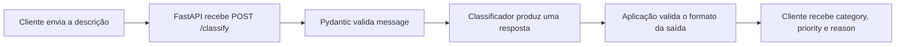

# AI Ticket Classifier

## O problema

Uma pessoa ou um sistema de suporte recebe uma descrição em linguagem natural e precisa triá-la. A API vai sugerir uma **categoria**, que ajuda a encaminhar o chamado, e uma **prioridade**, que depende do impacto do problema. A resposta inclui uma justificativa curta. A proposta inicial é apoiar a triagem usando chamados sintéticos.

**Hoje existe** um exercício funcional de FastAPI, com `GET /`. A rota `POST /classify` está planejada. O escopo inicial termina na resposta JSON. Interface de usuário, armazenamento de chamados e integração com plataformas de suporte ficam para uma necessidade posterior.

## O caminho da requisição

1. **Entrada.** O FastAPI encaminha o corpo da requisição ao modelo de entrada do Pydantic. A proposta é aceitar texto com conteúdo e responder com `422` quando o campo obrigatório for inválido.
2. **Decisão.** Na primeira versão, uma função Python devolve uma resposta fixa identificada como simulação. Na integração real, um LLM recebe o chamado e os critérios de triagem. Mais adiante, um classificador supervisionado usa padrões aprendidos a partir de chamados rotulados.
3. **Saída.** A aplicação verifica se os campos e valores têm o formato combinado e devolve o JSON. Na integração, falhas do provedor, como timeout ou saída inválida, ganham tratamento próprio. Um resultado no formato esperado ainda pode atribuir a prioridade errada. [Corpo de requisição no FastAPI](https://fastapi.tiangolo.com/tutorial/body/) · [Modelo de resposta](https://fastapi.tiangolo.com/tutorial/response-model/)

As abordagens serão exercitadas no mesmo contrato HTTP, uma de cada vez. O trabalho inicial cabe em `app.py`. Quando houver uma integração real, o módulo de inferência pode ganhar um arquivo próprio para que a rota cuide de HTTP e o módulo cuide do modelo.

### O que significa classificar bem

Categoria e prioridade respondem a perguntas diferentes. Uma falha de conexão pode indicar infraestrutura. Para decidir a prioridade, importa saber se a falha afeta um ambiente de teste ou impede clientes de usar o sistema em produção. Vamos confirmar as categorias, os critérios de impacto e o tratamento de informações insuficientes antes de classificar chamados reais. A explicação de um modelo clássico também exige uma estratégia própria, pois o classificador retorna rótulos.

Os testes do endpoint verificam a entrada, a resposta e os erros observáveis. A avaliação de qualidade roda fora da rota e compara as previsões com rótulos revisados por uma pessoa. Vamos medir categoria e prioridade separadamente, revisar erros por classe e comparar também latência, custo e manutenção. Com 30 a 50 exemplos a avaliação inicial será exploratória.

## Roadmap do projeto

| Momento | O que vamos construir | Como conferir |
| --- | --- | --- |
| Ponto de partida | Exercício `GET /` e ambiente local. | A rota devolve JSON e aparece na OpenAPI. |
| Começo | `POST /classify` simulado, com entrada e saída tipadas. | Explicar o fluxo, prever entradas que geram `422` e cobrir sucesso e erro com testes HTTP. |
| Meio | Critérios de triagem, LLM pré-treinado e primeiros chamados rotulados. | Revisar exemplos claros e ambíguos, testar saída estruturada e falhas e obter a primeira medição de qualidade. A escolha entre API hospedada e modelo local será feita com base em custo, privacidade, qualidade e viabilidade. |
| Fim do laboratório | Treinar um classificador clássico e comparar as abordagens em chamados reservados para avaliação. | Produzir uma comparação reproduzível, explicar os erros mais relevantes e justificar a escolha. |
| Evolução | Preparar a abordagem escolhida para operação quando houver um contexto de uso. | Definir como publicar, monitorar falhas, qualidade, latência e custo. |

O primeiro conjunto pode ser usado para explorar critérios e melhorar o prompt. Para sustentar a comparação final, vamos reservar dados independentes do treinamento e dos ajustes. A quantidade de exemplos para treinar o classificador clássico será decidida com base na cobertura das classes e nos resultados. [Como evitar vazamento de dados no scikit-learn](https://scikit-learn.org/stable/common_pitfalls.html#data-leakage)

**Para começar agora**, percorra o diagrama com um chamado de exemplo e diga em qual etapa uma mensagem sem conteúdo deve parar. Depois disso, o primeiro trecho de implementação é o modelo de entrada. A atividade atual está no [task.md](../../task.md).
